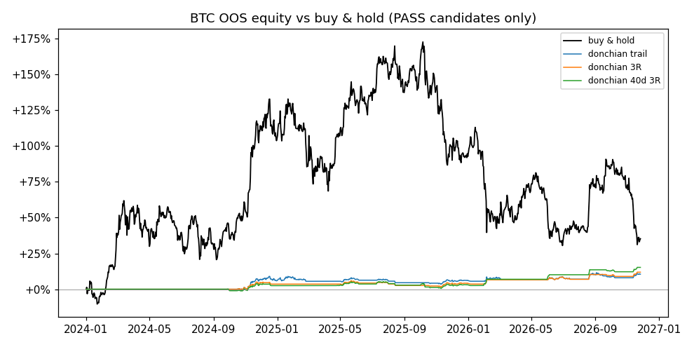
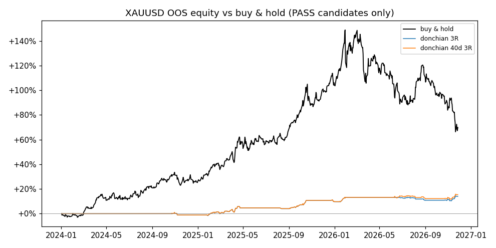

# Desk run 2026-11-26

Verdict rules (fixed before the run): PASS = OOS trades >= 8,
OOS sharpe > 0.3, OOS return > 0. OOS = from 2024-01-01.
Costs per side: BTC 25 bps, gold 3 bps. 1% risk per trade.
A PASS that trails buy & hold after costs is flagged - the
protocol says such a strategy has no reason to exist.

## BTC (OOS 2024-01-01 .. 2026-11-26, buy&hold +35.3%)

| candidate | verdict | OOS ret | sharpe | maxDD | trades | beats B&H |
|---|---|---|---|---|---|---|
| donchian trail | PASS | +10.5% | 0.61 | -5.0% | 10 | NO |
| donchian 3R | PASS | +11.9% | 0.93 | -4.2% | 13 | NO |
| donchian 40d 3R | PASS | +15.3% | 1.09 | -4.6% | 15 | NO |
| rsi mean-rev | FAIL | +3.8% | 0.88 | -0.9% | 6 | NO |
| sma cross trail | FAIL | +0.3% | 0.04 | -4.1% | 10 | NO |
| sma cross 3R | FAIL | +6.0% | 0.65 | -3.0% | 6 | NO |
| sma 50/100 trail | FAIL | +4.1% | 0.26 | -5.0% | 5 | NO |

## XAUUSD (OOS 2024-01-02 .. 2026-11-26, buy&hold +69.9%)

| candidate | verdict | OOS ret | sharpe | maxDD | trades | beats B&H |
|---|---|---|---|---|---|---|
| donchian trail | FAIL | +16.2% | 0.77 | -8.3% | 6 | NO |
| donchian 3R | PASS | +14.0% | 1.35 | -2.6% | 13 | NO |
| donchian 40d 3R | PASS | +15.4% | 1.43 | -2.5% | 13 | NO |
| rsi mean-rev | FAIL | +0.8% | 0.27 | -1.4% | 7 | NO |
| sma cross trail | FAIL | +19.7% | 0.97 | -7.4% | 2 | NO |
| sma cross 3R | FAIL | +9.6% | 1.76 | -1.2% | 3 | NO |
| sma 50/100 trail | FAIL | +2.7% | 0.89 | -0.8% | 0 | NO |

